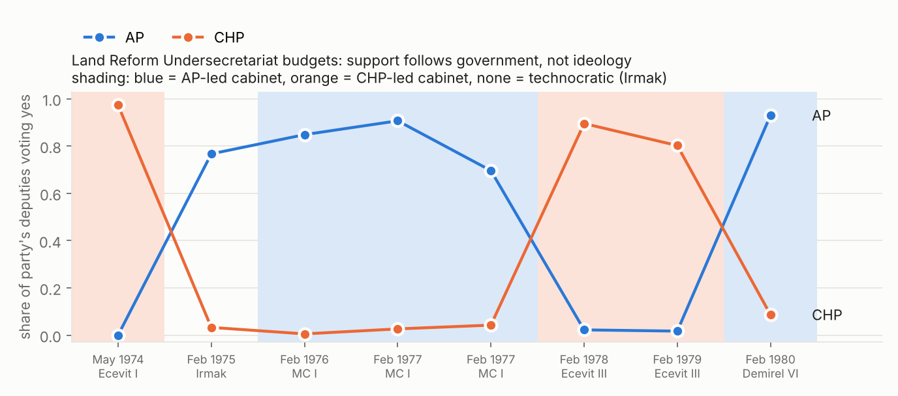
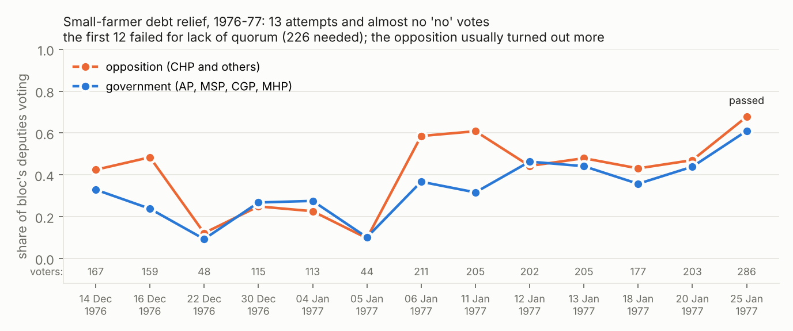

# Who voted for land reform and farm benefits? Roll calls in the Turkish parliament, 1961–1980

This report covers the recorded (open, by-name) votes only. Most decisions in this period were
taken by show of hands and left no individual record. Everything below describes the 567
recorded land and agricultural roll calls (182,005 member-votes).

Scripts: `analysis/01_code_votes.py` (coding), `02_tests.py` (tests), `03_figures.py`.
Tables: `analysis/output/t*.csv`.

---

## 1. What kinds of votes are these?

Each roll call was coded by policy content (`analysis/output/votes_coded.csv`).

| policy type | votes (MM / CS) | what it is |
|---|---|---|
| **land reform** | 3 (2 / 1) | 1965 motion to send İnönü's land-reform bill to a joint committee (rejected 157–167); the 1973 Toprak ve Tarım Reformu Kanunu (passed in both chambers) |
| **land reform agency budgets** | 17 (8 / 9) | yearly budgets of the Land and Agrarian Reform Undersecretariat, 1974–80 |
| **land tax** | 12 (8 / 4) | Arazi Vergisi change (1964); Emlâk Vergisi law and amendments (1970–72) |
| **land titling / settlement / forest land** | 47 (12 / 35) | Tapulama (cadastral titling) law 1963–66, much of it article by article in the Senate; İskân law 1970; the 1973 forest-land definition (Orman Kanunu); AOÇ land sale |
| **farm subsidies & benefits** | 43 (31 / 12) | debt relief (17), commodity support boards (12: tea, tobacco, milk), credit (6), disaster relief (4), farm income tax relief (2), input tariff relief (2) |
| agency budgets *(baseline)* | 259 | budgets of DSİ, State Farms, Forestry, Agriculture Ministry |
| final accounts *(baseline)* | 114 | approval of past years' accounts |

**How contested each type is** (all roll calls, both chambers):

| | share failing quorum | turnout | yes share of votes cast | lopsided (≥90% one way) | share of cast votes that are "no" |
|---|---|---|---|---|---|
| land reform (law, motion) | 0% | 69% | 78% | 33% | 26% |
| land reform agency budgets | 0% | 69% | 67% | 6% | **37%** |
| land tax | 42% | 41% | 77% | 33% | 23% |
| land titling etc. | 38% | 49% | 87% | 66% | 10% |
| **farm subsidies & benefits** | **47%** | 46% | **93%** | **88%** | **4%** |
| agency budgets | 23% | 59% | 84% | 50% | 18% |
| final accounts | 33% | 52% | 97% | 92% | 3% |

These are two different kinds of politics:
- **Redistribution of land:** land reform, its agency, and land taxation are contested. Turnout
  is high when the vote counts, many votes are cast against, and the votes split along party lines.
- **Farm benefits:** almost nobody votes against them (4% of cast votes). These bills die by
  failing quorum instead: nearly half of the benefit roll calls failed for lack of a quorum.

---

## 2. Theories tested

The tests use linear probability models with roll-call fixed effects and standard errors
clustered by deputy, on Assembly votes, because party affiliation is known only for deputies.
Party at the time of each vote is taken from the elites data, using the known dates of the
major splits (§5).

### 2.1 Government versus opposition (executive dominance, budgets as confidence votes)

**Theory:** In parliamentary systems with disciplined parties, votes on the cabinet's programme
are about government survival, not policy. Legislators vote with their party's role, government
or opposition, rather than their preferences (Cox 1987; Huber 1996; Diermeier & Feddersen 1998).

**Test:** how much of the variation in yes votes, beyond the roll call itself, is explained by
government status alone, by party alone, or by both (contested Assembly votes only).

| | contested votes | R² government | R² party | R² both | effect of being in government, within party |
|---|---|---|---|---|---|
| land reform agency budgets | 8 | **0.76** | 0.15 | 0.80 | **+0.92\*\*\*** |
| land tax | 7 | **0.46** | 0.16 | 0.55 | +0.84\*\*\* |
| agency budgets (baseline) | 95 | 0.51 | 0.24 | 0.55 | +0.67\*\*\* |
| land titling etc. | 4 | 0.09 | **0.57** | 0.65 | +0.35\*\*\* |
| farm benefits | 2 | 0.49 | 0.62 | 0.62 | −0.43\*\*\* |

**Party flips.** Share of AP and CHP deputies voting yes when their party was in government and
when it was in opposition (the technocratic cabinets of 1971–74 and 1974–75 are excluded):

| | AP in opposition | AP in government | CHP in opposition | CHP in government |
|---|---|---|---|---|
| land reform agency budgets | 0.03 | **1.00** | 0.05 | **1.00** |
| land tax | 0.15 | 0.89 | 0.05 | 0.99 |
| agency budgets (baseline) | 0.50 | 0.97 | 0.32 | 0.99 |
| farm benefits | 0.96 | 0.99 | 0.99 | 0.84 |



**Verdict: strongly supported, and the best single explanation of land-reform politics after 1973.**
- AP voted almost unanimously against the land reform agency's budget under Ecevit (1974, 1978,
  1979) and almost unanimously for it under its own Nationalist Front cabinets (1976, 1977) and
  under Demirel in 1980. The same agency, the same law, opposite votes.
- CHP did the mirror image.
- Cohesion (the Rice index, which measures how united a party votes) is 0.97 for AP and 0.94 for
  CHP on these budgets. All 8 Assembly votes on them were party-line votes, with the AP and CHP
  majorities on opposite sides.

### 2.2 Partisan or class ideology (left parties redistribute land, right parties resist)

**Theory:** Land reform is redistribution; left-of-centre parties representing peasants and
labour push it, right parties representing property owners block it (Huber & Stephens; Lipton;
for Turkey, CHP's "left of centre" turn after 1965).

**Evidence:** the two genuine land reform roll calls point in opposite directions.
- **1965 (İnönü, CHP-led):** CHP 142–2 for sending the bill to a joint committee; AP 2–127
  against; the small right-wing parties (YTP, CKMP, MP) also overwhelmingly against. This is a
  clean left–right split, and the bill died.
- **1973 (Talu, AP-led, after the 1971 military memorandum):** AP voted 198–1 **for** the
  Toprak ve Tarım Reformu Kanunu. CHP did not vote: 2 of 105 deputies took part. The Democratic
  Party (DP), a 1970 AP splinter, was the only bloc to vote against (0–4, 33 absent).
- Land tax: CHP voted for it when governing (1964) and against when AP governed (1970). AP did
  the reverse.

**Verdict: weak and conditional.** Ideology shows up only before the 1971 military memorandum
(1964–65). After that, party positions on land reform are explained by government role (§2.1).
The right-wing party passed land reform, and the left-wing party opposed the agency's budget
whenever it was out of power.

### 2.3 Landed elites and authoritarian redistribution (Moore 1966; Albertus 2015)

**Theory:**
- Legislatures in which landed elites are represented block land reform.
- Land redistribution happens when ruling political elites are split from landed elites,
  typically under military or authoritarian rule (Albertus 2015, *Autocracy and Redistribution*).

**Evidence:**
- The only land reform law of the period passed under a military-supervised "above-party"
  government (Talu, 1973). Its precursor, the 1972 pre-measures law (Öntedbirler), passed by show
  of hands after the military's 1971 memorandum. Under fully competitive party government (1965)
  the land reform bill was rejected.
- **Party level.** The DP, the most landowner-aligned party, voted against land taxation in
  1971–72 (9 yes, 32 no across four votes), against the 1973 law and against most of the
  agency's budgets, whoever governed. Its only yes votes came on the 1975 budget under the
  technocratic Irmak cabinet. It is the one party whose position does not flip with government.
- **Individual level.** Deputies from the East and Southeast, where large holdings by tribal
  landlords (*ağa*) were common, do **not** vote differently from their party colleagues on any
  land vote (table 2.6). On the 1965 motion, 80% of eastern AP deputies voted no against 77% of
  other AP deputies (Fisher's exact test, p = 1.0). On the 1973 law, 83% of eastern AP deputies
  voted yes against 89% of others (p = 0.28).

**Verdict: supported for timing and parties, not for individual deputies.** Landed interest
works through parties (AP before 1971, DP after) and through the choice of when reform happens
(under military tutelage). It does not show up as regional rebellion inside parties: in a
disciplined party system, landlord deputies have no need to defect.

### 2.4 Military and bureaucratic tutelage: reform from above (Trimberger 1978; Keyder 1987; Heper)

**Theory:** In Turkey, redistributive and modernising reform comes from the state elite (military
and bureaucracy), not from elected politicians.

**Test:** the Senate's unelected members are the natural (*tabii*) senators, members of the
1960 junta (the National Unity Committee, NUC), and the senators appointed under the President's
quota. They are compared with elected senators.

| Senate, share yes among votes cast | elected | natural (NUC) | presidential quota |
|---|---|---|---|
| land reform agency budgets | 0.69 | **0.86** | **0.91** |
| land tax | 0.90 | **1.00** | 0.96 |
| land titling etc. | 0.88 | 0.74 | 0.82 |
| farm benefits | 0.93 | 0.93 | 0.88 |
| 1973 land reform law | 105–10 (1 abstained) | 15–1 | 4–2 (1 abstained) |

**Verdict: moderately supported.**
- The junta senators back the land reform agency and land taxation more consistently than
  elected senators do.
- The 1973 law came out of the post-memorandum regime.
- But the junta senators are *less* supportive than elected senators on the 1963 cadastral
  titling articles. Titling formalised existing private claims, so it is not redistribution.

### 2.5 Distributive politics: universalism and agenda control (Weingast 1979; Cox & McCubbins 2005)

**Theory:**
- Benefits with concentrated beneficiaries and diffuse costs pass by near-universal coalitions;
  no legislator wants to be seen voting against farmers.
- Majority parties then control *which* benefits pass by agenda gatekeeping, not by voting no.

**Evidence:**
- 93% of votes cast on farm benefits are yes, and 88% of those roll calls are lopsided. AP and
  CHP each vote yes on benefits at a 96–99% rate, whether in government or not.
- **Gatekeeping happens through absence.**
  - On benefit roll calls that failed for lack of quorum, government deputies were **10.4
    percentage points less likely to turn up** than opposition deputies of the same party
    family (p < 0.001).
  - On ordinary agency budgets the sign is the opposite: government deputies turn up 12.7
    points more.
- The 1976–77 small-farmer debt relief bill is the clearest case (figure 2):
  - It was voted on 13 times, and nearly every vote cast was yes.
  - The first 12 attempts failed for lack of quorum, during the Nationalist Front
    government (AP, MSP, CGP, MHP).
  - The opposition (CHP) usually turned out more than the government bloc.
  - It finally passed on 25 January 1977 with 286 voters, five months before the June 1977
    election.
- In 1963 a debt relief motion came from Mustafa Kepir (Yozgat), a deputy of the junior
  coalition partner CKMP. The opposition AP backed it 78–1, while CHP (7–81) and YTP (6–31), the
  other coalition parties, voted it down outright.



**Verdict: strongly supported.** Farm benefits follow universalism plus gatekeeping. The
government does not vote against farmers; it denies the quorum.

### 2.6 Constituency interest: rural representation and the development paradox (Bates 1981; Anderson & Hayami 1986; Olson 1985)

**Theory:**
- Deputies from rural constituencies favour farm support. Agricultural protection rises with
  democratic representation of farmers.
- Deputies with agricultural expertise or local roots should be more supportive.

**Test:** effects within party and roll call (vote and party fixed effects). The table shows
coefficients on the probability of voting yes and of turning out.

| | rural share of province | East/Southeast | agriculture or forestry degree | law degree | military education | local-born |
|---|---|---|---|---|---|---|
| farm benefits: yes | −0.01 | +0.03 | +0.10 | −0.01 | −0.10\* | 0.00 |
| farm benefits: turnout | +0.01 | −0.03 | 0.00 | 0.00 | +0.01 | +0.03 |
| land reform agency budgets: yes | −0.02 | 0.00 | +0.05 | −0.01 | +0.04 | 0.00 |
| land tax: yes | +0.12 | +0.06 | −0.01 | −0.04 | +0.03 | +0.02 |
| agency budgets: turnout | +0.05 | +0.01 | +0.01 | −0.02\* | 0.00 | +0.04\*\*\* |

**Verdict: not supported at the individual level.**
- Once party and government role are held fixed, how rural a deputy's province is, eastern
  origin, and agricultural training explain almost nothing.
- The only consistent effect is that locally born deputies turn up more often.

There are two ways to read this:
- Agricultural constituency interest is so universal that every party internalises it, which
  fits the near-unanimity on benefits.
- Turkish party discipline leaves no room for constituency voting on recorded votes.

Either way, the "rural interest" in this period acts through parties, not through cross-party
farm blocs.

### 2.7 Centre and periphery (Mardin 1973)

**Theory:**
- The central elite (bureaucracy, military, CHP) carries a reformist, state-led project,
  including land reform and land taxation.
- The periphery parties (DP/AP tradition, MSP) represent rural property and resist state
  extraction, while championing benefits to peasants.

**Evidence:**
- **Supported.** Before 1971 the cleavage appears as expected: CHP for land reform and land tax
  in 1964–65, AP and the small right-wing parties against. The unelected "central" senators
  favour the land reform agency and land tax (§2.4). Periphery parties back benefit bills, such
  as AP's 78–1 support for the 1963 debt relief motion.
- **Not supported.** After 1973 the periphery party (AP) runs and funds the land reform agency
  whenever it governs, and CHP votes against the agency's budgets in opposition. The centre also
  supports benefits when out of power, e.g. CHP pushing debt relief in 1976–77.

**Verdict: supported before 1971.** After 1971 the cleavage is overwritten by government versus
opposition and by competitive populism.

### 2.8 Populism and clientelism (Sunar 1974; Keyder 1987; Sayarı 1977)

**Theory:** In the 1960s–70s, parties competed for rural votes by handing out credit, support
prices and debt forgiveness. Agricultural policy was patronage rather than programme.

**Evidence:**
- Near-unanimous support for every kind of benefit.
- Benefit bills are backed most by whichever party is in opposition (AP in 1963, CHP in 1976–77)
  and stalled by the governing parties, by voting them down in 1963 and by quorum denial in
  1976–77.
- Passage clusters just before elections. The debt relief and natural-disaster relief laws both
  passed in January 1977, ahead of the June 1977 election.
- Credit expansion passes when the sponsoring party governs: the 1979 Ziraat Bankası law got
  CHP 172–0, with AP mostly absent.

**Verdict: supported.**

---

## 2b. Other agricultural policies: credit, price support and rural infrastructure

**What parliament voted on by name:**
- **Agricultural credit:** 23 roll calls.
  - Ziraat Bankası law changes (1963, 1979).
  - The Tarım Kredi Kooperatifleri law (1972).
  - Farmer debt relief (1963, 1976–77).
- **Commodity support boards:** 12 roll calls on the tea board (ÇAYKUR, 1971–72), the tobacco
  monopoly law (1969) and the milk industry board (1963).
- **Input subsidies:** 2 roll calls (1962) removing customs duties on fertiliser and tractors.
- **Rural infrastructure:**
  - DSİ (irrigation and dams): 147 roll calls (109 budgets, 35 final accounts, 3 other).
  - The Village Affairs Ministry law (1971), which created the ministry in charge of village
    roads, drinking water and electrification (YSE).
  - The Village Law amendments (1963, 19 article votes in the Senate).
- **State farms and agencies (TİGEM/DÜÇ, plant protection, Forestry):** 144 budgets and 79
  final-accounts votes.

**What never came to a recorded vote:**
- **Support prices.** Crop support prices and the grain board's (TMO) purchases were set by
  Council of Ministers decree, not by law. The full index of 6,446 votes has no roll call on
  them.
- **SOE subsidies.** The same holds for subsidies delivered through state companies (fertiliser,
  sugar, meat) and for Ziraat Bankası credit ceilings.
- **Ministry budgets.** The Agriculture and Village Affairs ministries' budgets were voted
  inside the general budget law, by show of hands section by section. So most of the money for
  farmers is not observable through roll calls.

**How parties voted on infrastructure and agency budgets** (Assembly, share of cast votes that
are yes, technocratic cabinets excluded):

| agency | AP in government | CHP in opposition | AP in opposition | CHP in government |
|---|---|---|---|---|
| DSİ irrigation and dams | 0.95 | 0.26 | 0.68 | 1.00 |
| State farms and agencies | 0.95 | 0.38 | 0.34 | 0.97 |
| Forestry | 0.99 | 0.33 | 0.35 | 1.00 |

Infrastructure budgets follow the same government-versus-opposition logic as the land reform
agency, with one difference. Irrigation is the least partisan item: AP in opposition still gave
DSİ budgets 68% support, against 34–35% for the other agencies. This fits the distributive
reading, since irrigation projects are geographically targeted and attractive to every deputy.

The 1971 law creating the Village Affairs Ministry got 116–2 from AP and 89–1 from CHP. As with
farm benefits, nobody voted against it; it failed quorum twice before passing.

**Verdict:** credit, subsidies and infrastructure behave like the farm-benefit votes in §2.5
(near-universal support, rationed by quorum control), except for annual agency budgets. Budgets
are confidence votes and split government against opposition, with irrigation the least
contested.

---

## 3. Summary

| theory | verdict | key evidence |
|---|---|---|
| Government vs opposition | **strong** | land reform budgets: R² 0.76 from government status alone; AP and CHP flip 0.03 ↔ 1.00 |
| Partisan/class ideology | weak, pre-1971 only | 1965 CHP 142–2 vs AP 2–127; 1973 AP 198–1 for, CHP absent |
| Landed elites & authoritarian redistribution | supported (timing, parties) | only land reform law passed under military tutelage; DP 9–32 against land tax |
| Landlord regions (East/SE) | not supported individually | no within-party East/SE effect on any land vote |
| Military/bureaucratic reform from above | moderate | junta senators 0.86 vs elected 0.69 yes on agency budgets; 1.00 vs 0.90 on land tax |
| Distributive universalism + gatekeeping | **strong** | 4% "no" votes on benefits; government deputies 10 points less likely to attend failed-quorum benefit votes |
| Rural constituency / development paradox | not supported individually | no rural-share, East/SE or agriculture-degree effects within party |
| Centre–periphery (Mardin) | supported before 1971 | 1964–65 votes; reversed after 1973 |
| Populism / clientelism | supported | benefits pushed by the opposition, blocked by absence, passed before elections |

**Summary.** On recorded votes, Turkish agrarian politics in 1961–80 had two separate logics:
- **Land redistribution and land taxation** were partisan battles in which party positions
  followed government status. Land reform happened only when the military tied the right's
  hands (1971–73). The one party that consistently defended landed property regardless of office
  was the DP splinter.
- **Farm benefits** were consensual. Parties competed to give them, and governments rationed
  them by keeping quorums from forming rather than by voting them down.
- Individual constituency traits barely matter once party and government role are accounted for.

---

## 4. What the roll-call data cannot show

- **Selection.**
  - Open votes were compulsory for budgets, final accounts and the final passage of some
    laws, and taken on request otherwise. Many decisive agrarian votes were not recorded,
    e.g. the 1972 Öntedbirler law.
  - Benefits decided administratively are not in this data at all: support prices, credit
    ceilings, TMO purchases.
- **Few true land-reform votes.** There are 2 Assembly roll calls and 1 in the Senate, so §2.2
  and §2.3 lean on the budgets and the land tax.
- **Party at the time of the vote is approximate.** The elites data gives each deputy's career
  string (e.g. `CHP/BAĞIMSIZ/GP`), not dates. Known splits are dated:
  - CHP → GP, May 1967
  - AP → DP, Dec 1970
  - CHP → CGP, Nov 1972
  - DP → AP, 1975
  - AP → CHP, Jan 1978

  Other switches are placed at mid-term. About 18% of deputies switched at some point.
- **Senate parties are unknown.** The elites dataset covers deputies only, so the Senate is
  analysed by member type (elected, junta, presidential quota) instead.
- **Landownership is unobserved.** The elites occupation field is too coarse: 45% of deputies
  are coded "Other". Region is used as a proxy for landlord influence; deputies' own land
  holdings would be a much better test.
- **Data quality.** All 73 land votes match the printed lists exactly. 400 of the 554 roll calls
  match exactly, and the rest are within a few names (see `votes_quality.csv`).

## Robustness

| | all votes | exact-quality votes only | excluding party switchers |
|---|---|---|---|
| land reform budgets: effect of being in government (no party controls) | +0.91 (R² 0.76) | +0.91 (0.76) | +0.94 (0.80) |
| land tax: effect of being in government | +0.71 (R² 0.46) | +0.71 (0.46) | +0.89 (0.60) |
| agency budgets: effect of being in government | +0.66 (R² 0.51) | +0.67 (0.52) | +0.73 (0.60) |
| farm benefit votes that failed quorum: effect of being in government on turnout | −0.104\*\*\* | −0.122\*\*\* | −0.087\*\* |

All results hold. Excluding the deputies whose party at the time of the vote is approximated
makes the government–opposition pattern stronger, not weaker.

## 5. Reproduce

```bash
python3 analysis/01_code_votes.py
python3 analysis/02_tests.py
python3 analysis/03_figures.py
```

Requirements: pandas, statsmodels, matplotlib.
